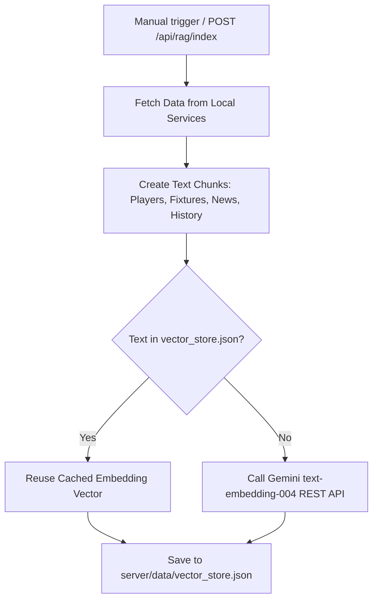
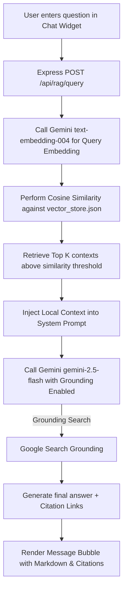

# BarçaPulse RAG (Retrieval-Augmented Generation) System Documentation

This document explains the architecture, workflow, technologies, and setup instructions for the **BarcaBot AI Assistant** integrated into BarçaPulse.

---

## 1. System Overview

**BarcaBot** is an intelligent, real-time AI chat assistant that answers questions about FC Barcelona. It uses a hybrid RAG (Retrieval-Augmented Generation) architecture:
1. **Local Context Retrieval**: It searches a local vector database containing real-time data from the website (player statistics, upcoming fixtures, latest news articles, and static club legacy data).
2. **Google Search Grounding**: For questions outside the scope of our database (e.g. historical matches, transfers, or broad football knowledge), it utilizes Gemini's official Google Search Grounding to fetch verified real-time facts from the web.

---

## 2. Architecture & Data Workflow

### Indexing Flow (Ingesting Site Data)


### Query Flow (Answering Questions)


---

## 3. Technology Stack & Components

No external complex database or heavy machine learning libraries (Python/FastAPI) are required. The entire pipeline is built in vanilla Node.js:

* **Large Language Model**: Google Gemini API (`gemini-2.5-flash` for completions, `text-embedding-004` for vectors).
* **Search Grounding**: Google Search Tool enabled on the Gemini chat API.
* **Vector Store**: A lightweight, file-based JSON database (`server/data/vector_store.json`).
* **Vector Math**: Cosine similarity computed in plain JavaScript using vector dot-products.
* **HTTP Client**: `axios` (used for direct REST requests to Gemini endpoints, avoiding heavy SDK downloads).
* **Aesthetics**: Custom glassmorphic CSS animations, scroll snapping suggestions, and dynamic chat bubble templates using FontAwesome icons.

---

## 4. Vector Chunking Strategy

To match user queries with the correct information, the system splits data into descriptive paragraphs (chunks) before calculating embeddings:

1. **Players**: Merges stats from API-Football (goals, assists, matches played, rating, shirt number) into a biography chunk.
   * *Example*: `"Player Profile: Robert Lewandowski (shirt #9) is a 37-year-old Forward from Poland. In the 2025/2026 season, he has played 24 matches, scoring 19 goals..."`
2. **Upcoming Fixtures**: Converts match fixture lists into readable schedules.
   * *Example*: `"Upcoming Match: FC Barcelona plays against Real Madrid (Away) in La Liga on November 29, 2026..."`
3. **News**: Takes the top articles fetched from NewsAPI, filters for Barca keywords, and embeds the headlines and description summaries.
4. **Legacy History**: Static chunks containing club foundation details (1899), Camp Nou stadium information, La Masia academy, and official trophy cabinet counts.

> [!TIP]
> **Performance Optimization (Cache Reuse)**: 
> Calculating embeddings for 50+ players and news items can take up to 20 seconds and hit rate limits. The indexer checks `vector_store.json` before sending a request. If the text description matches exactly, it reuses the existing vector. This makes re-indexing complete in milliseconds instead of seconds.

---

## 5. Setup & Installation

### Step 1: Get a Gemini API Key
1. Go to the [Google AI Studio](https://aistudio.google.com/).
2. Log in with your Google account.
3. Click **Get API Key** and create a new key.

### Step 2: Configure Environment Variables
Open your `.env` file in the root of the project and add your API key:
```bash
NEWS_API_KEY=your_news_key
FOOTBALL_DATA_API_KEY=your_football_data_key
API_FOOTBALL_KEY=your_api_football_key
GEMINI_API_KEY=your_gemini_api_key
```

### Step 3: Run the Indexer
To build your vector database for the first time, start the server and run the indexer using curl:
```bash
# Start the server
node server.js

# Trigger the indexer (in another terminal)
curl -X POST http://localhost:3000/api/rag/index
```
This will generate `server/data/vector_store.json`.

---

## 6. API Reference

### 1. Query RAG Assistant
* **URL**: `/api/rag/query`
* **Method**: `POST`
* **Content-Type**: `application/json`
* **Payload**:
  ```json
  {
    "message": "Who is FC Barcelona's number 9?",
    "history": [
      { "role": "user", "content": "Hello!" },
      { "role": "assistant", "content": "¡Hola! I am BarcaBot..." }
    ]
  }
  ```
* **Response**:
  ```json
  {
    "text": "Robert Lewandowski wears the number 9 shirt...",
    "sources": [
      {
        "title": "Local BarçaPulse Database (players)",
        "url": "#players"
      }
    ]
  }
  ```

### 2. Rebuild Vector Index
* **URL**: `/api/rag/index`
* **Method**: `POST`
* **Response**:
  ```json
  {
    "success": true,
    "totalChunks": 42,
    "apiCalls": 5,
    "cachedReused": 37
  }
  ```

---

## 7. Frontend Features

* **Glassmorphic HUD Overlay**: Chat panel matches the Barça colors (Blaugrana) using backdrops and blur.
* **Citations & References**: Search results return source badges. Clicking local badges (like `#players`) closes the chat panel and scrolls smoothly to the section. External badges open in a new tab.
* **Quick Suggestions**: Buttons for popular questions ("Who is Barca's coach?", "Next match?", "Who is number 9?") that users can click to chat instantly.
* **Typing Indicator**: Features a custom pulsing dot animation when querying the AI.
